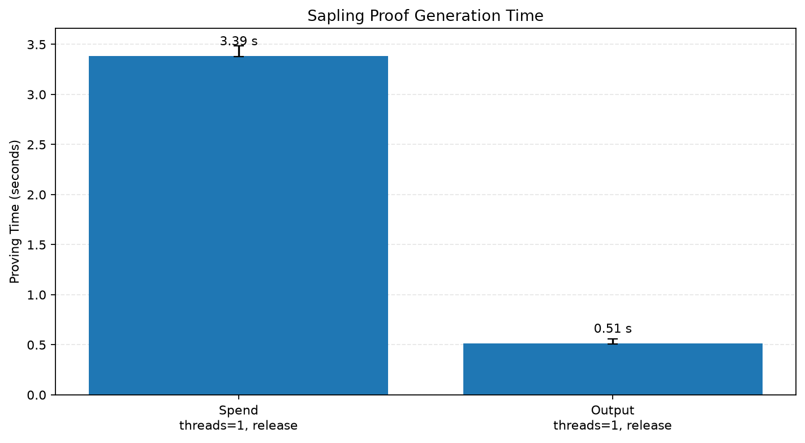
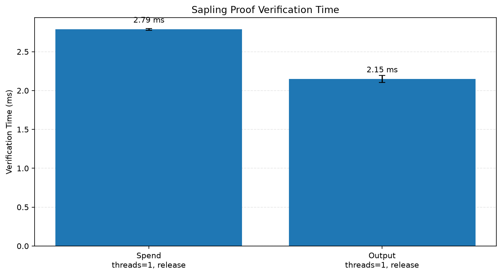
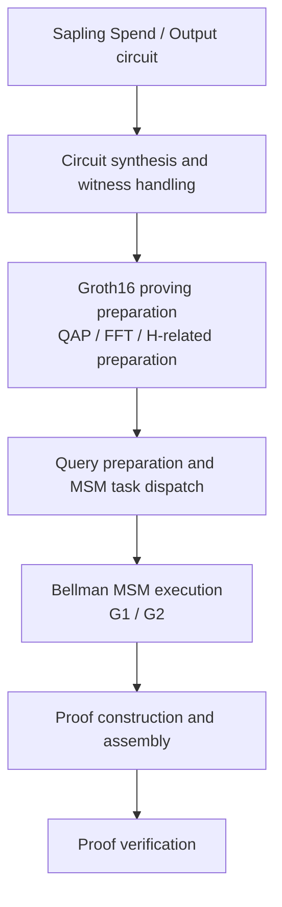
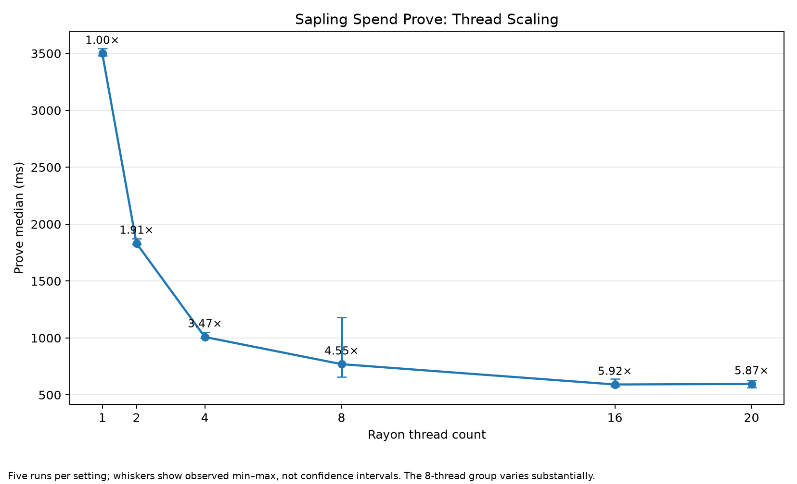
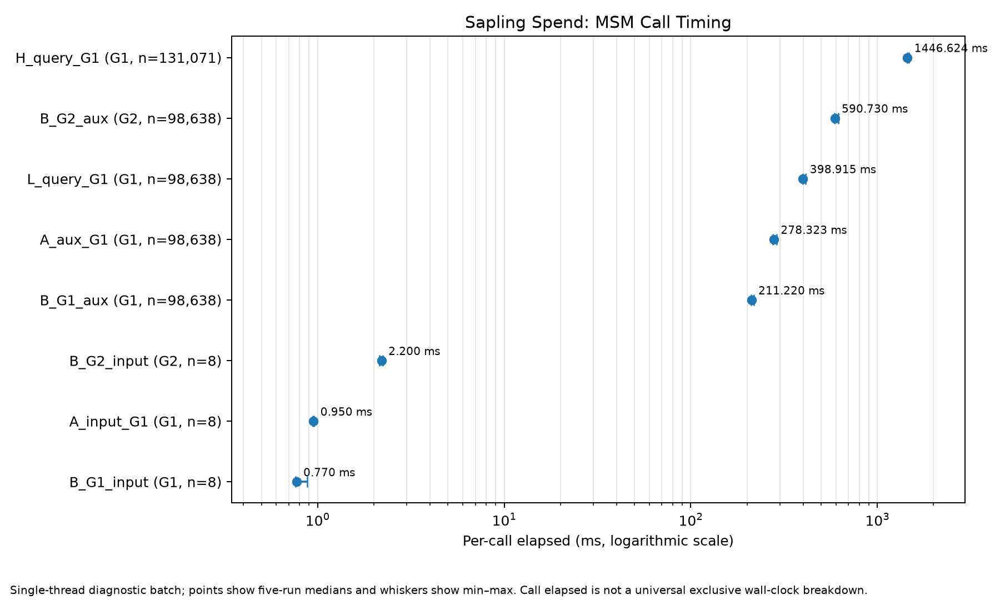
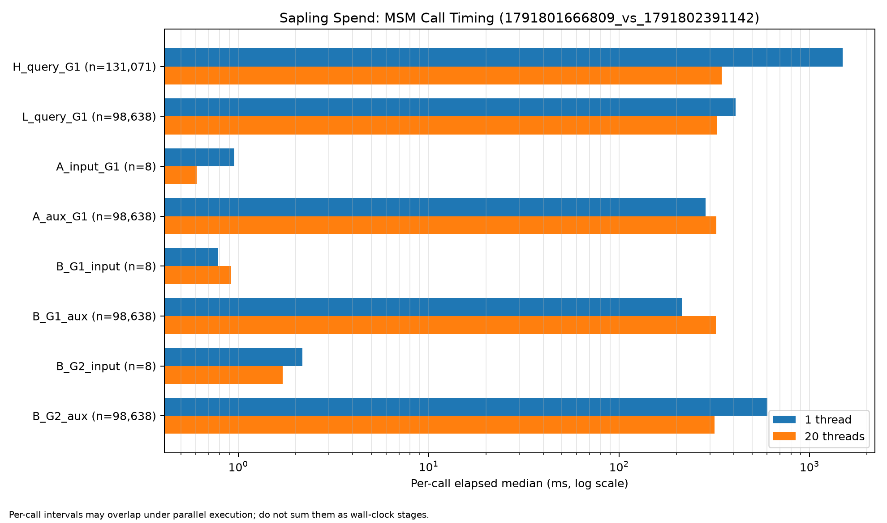

# Zcash Sapling Engineering

**A reproducible engineering study of Zcash Sapling zk-SNARK proving performance**

This repository investigates the computational cost of Sapling Spend and Output proof generation through release-mode benchmarks, source-level instrumentation, thread-scaling experiments, and system-level diagnostics. Its current contribution is an engineering measurement framework and an evidence-based bottleneck analysis—not a new cryptographic construction or a completed algorithmic optimization.

> **Current research status (2026-10-12):** the formal proving baseline, parameter validation, source-level Groth16/Bellman profiling, MSM call analysis, thread-scaling measurements, selected memory/CPU/cache diagnostics, and provenance records have been collected. The strongest current hypothesis concerns the interaction between MSM execution and Bellman worker fallback behavior in the single-thread Spend path. The independent causal contribution of fallback has not yet been isolated.

## Contents

- [1. Project Scope](#1-project-scope)
- [2. Research Questions](#2-research-questions)
- [3. Proving Workflow](#3-proving-workflow)
- [4. Current Experimental Environment](#4-current-experimental-environment)
- [5. Formal Baseline Results](#5-formal-baseline-results)
- [6. Parameter Files and Circuit Scale](#6-parameter-files-and-circuit-scale)
- [7. Thread-Scaling Results](#7-thread-scaling-results)
- [8. Source-Level Stage and MSM Profiling](#8-source-level-stage-and-msm-profiling)
- [9. Worker Fallback Investigation](#9-worker-fallback-investigation)
- [10. System-Level Diagnostics](#10-system-level-diagnostics)
- [11. How to Interpret the Measurements](#11-how-to-interpret-the-measurements)
- [12. Repository Layout](#12-repository-layout)
- [13. Important Research Artifacts](#13-important-research-artifacts)
- [14. Reproducing and Extending the Experiments](#14-reproducing-and-extending-the-experiments)
- [15. Data Integrity and Experiment Provenance](#15-data-integrity-and-experiment-provenance)
- [16. Current Conclusions](#16-current-conclusions)
- [17. Limitations and Open Questions](#17-limitations-and-open-questions)
- [18. Potential Future Research](#18-potential-future-research)
- [19. Upstream Projects and Licensing](#19-upstream-projects-and-licensing)

## Results at a Glance

| Recorded formal baseline | Sapling Spend | Sapling Output |
|---|---:|---:|
| Prove median | 3,385.716 ms | 514.853 ms |
| Verify median | 2.790 ms | 2.150 ms |
| Serialized proof size | 192 bytes | 192 bytes |
| Successful verification | 5/5 | 5/5 |

The figures below provide a visual entry point into the archived measurements. They are derived from repository data; the formal baseline plots should not be confused with the separate instrumented profiling batches discussed later.

<div align="center">
  
  
</div>

<p align="center"><em>Formal baseline overview: proving and verification latency. Lower values indicate less elapsed time; see the baseline section for the exact recorded medians and batch boundaries.</em></p>

## 1. Project Scope

Zcash Sapling uses zk-SNARKs to support privacy-preserving transactions. Proof verification is compact and comparatively inexpensive, while proof generation must perform the work required to construct and prove the validity of a circuit statement.

This project studies that proving cost using the actual Sapling proving implementation. It focuses on two workloads:

- **Sapling Spend:** the larger proving workload and the main target of the latest detailed bottleneck analysis.
- **Sapling Output:** a smaller proving workload used for baseline, thread, and MSM comparisons.

The repository records overall proving and verification times, proof size, parameter-file identity and serialized size, thread scaling, selected internal stage timings, MSM call timings, process working set, CPU samples, and exploratory cache-condition comparisons.

The project does not currently claim to have changed the Sapling protocol, invented a new SNARK, or demonstrated an algorithm-level optimization. Its purpose is to determine which costs merit controlled follow-up experiments.

## 2. Research Questions

### RQ1. What is the cost of Sapling proof generation?

Measure end-to-end Prove and Verify latency for Spend and Output, preserve successful-verification results, and record the relevant circuit, parameter, and proof-size information.

### RQ2. Which components dominate the proving workload?

Use source-level instrumentation to inspect Groth16 proving stages and Bellman MSM calls. Study how the following relate to the outer Prove time:

- Circuit synthesis and constraint construction.
- QAP / FFT / H-query preparation.
- Assignment and query preparation, task dispatch, and waiting.
- G1 and G2 multi-scalar multiplication (MSM).
- Worker task submission, task-start delay, and synchronous fallback behavior.

### RQ3. How does parallelism affect proving performance?

Compare selected Rayon thread counts and examine whether improvements are monotonic. Distinguish overall wall-clock time from individual task intervals, which can overlap under parallel execution.

### RQ4. Which apparent bottlenecks are supported by controlled evidence?

Separate direct observations from explanatory hypotheses. In particular, determine whether a suspected mechanism—such as worker fallback—can be independently changed while other relevant conditions remain comparable.

## 3. Proving Workflow

The measured path can be viewed at a high level as:



This is a conceptual map, not a strict timeline of non-overlapping phases. Some tasks execute asynchronously; in the single-thread fallback path, work may also execute synchronously during submission. The timing fields must therefore be interpreted according to their measurement boundaries rather than treated as a mutually exclusive partition of CPU time.

The project follows this workflow:

1. Prepare and identify the source, dependencies, toolchain, and parameter files.
2. Validate parameter file sizes and cryptographic hashes.
3. Measure formal Prove / Verify baselines.
4. Measure thread-scaling behavior.
5. Instrument relevant Groth16 and Bellman code paths.
6. Compare stages, MSM calls, submission delays, and system-level signals.
7. Preserve raw observations, logs, metadata, derived summaries, and limitations.

## 4. Current Experimental Environment

The principal engineering environment recorded for the latest Spend analysis is:

| Component | Configuration |
|---|---|
| CPU | Intel Core i7-14700 |
| Installed memory | 32 GB |
| Operating system | Windows 11 |
| Rust toolchain | Rust 1.98.1 for the current engineering setup |
| Build profile | Release for the performance measurements summarized here |
| Proof system | Groth16 |
| Curve | BLS12-381 |
| Sapling dependency | `sapling-crypto` 0.9.0 |
| Locked Sapling source revision | `88a7946b4a3066787776e11f0a502654167e022d` |
| Other instrumented dependencies | Local `vendor/bellman` 0.15.0 and `vendor/groth16` 0.2.0 trees |
| Parallel execution | Rayon; recorded thread count varies by experiment |

Earlier experiments may have used a different Rust toolchain or runner revision. For any particular measurement, the batch-specific metadata, raw logs, source hashes, parameter hashes, and recorded environment are authoritative. Do not infer all historical batches used an identical environment merely because they are stored in the same repository.

The parameter files are external to the repository and must be obtained and validated separately. They are not committed to Git.

## 5. Formal Baseline Results

The following values are the recorded formal-reference baseline medians. They are intentionally separated from instrumented diagnostic batches.

| Metric | Sapling Spend | Sapling Output |
|---|---:|---:|
| Prove median | 3,385.716 ms | 514.853 ms |
| Verify median | 2.790 ms | 2.150 ms |
| Serialized proof size | 192 bytes | 192 bytes |
| Successful verification | 5/5 | 5/5 |
| Spend baseline batch | `1791613854129` | — |
| Output baseline batch | — | `1791549582046` |

These values describe the archived batches and their specific configuration; they are not universal latency guarantees. In particular, the instrumentation experiments below have different run conditions and must not be averaged together with the formal baseline.

The formal baseline establishes the primary system-level observation: for the recorded workloads, producing a proof costs much more time than verifying it, while the proof remains 192 bytes in the selected serialization.

## 6. Parameter Files and Circuit Scale

### 6.1 Spend circuit scale

The recorded Sapling Spend circuit statistics are:

| Metric | Value |
|---|---:|
| Circuit constraints | 98,777 |
| Auxiliary variables | 98,638 |
| Spend parameter file size | 47,958,396 bytes |
| Spend parameter file size (approximately) | 45.74 MiB |
| Serialized proof size | 192 bytes |

The parameter file's byte size is not the same as the process working set, the memory needed while proving, the cost of generating the CRS, or the serialized proof size.

### 6.2 Parameter-file integrity

The repository's validation tool checks expected sizes and BLAKE2b-512 hashes.

| File | Expected size | Expected BLAKE2b-512 |
|---|---:|---|
| `sapling-spend.params` | 47,958,396 bytes | `8270785a1a0d0bc77196f000ee6d221c9c9894f55307bd9357c3f0105d31ca63991ab91324160d8f53e2bbd3c2633a6eb8bdf5205d822e7f3f73edac51b2b70c` |
| `sapling-output.params` | 3,592,860 bytes | `657e3d38dbb5cb5e7dd2970e8b03d69b4787dd907285b5a7f0790dcc8072f60bf593b32cc2d1c030e00ff5ae64bf84c5c3beb84ddc841d48264b4a171744d028` |

The hashes above are the expected BLAKE2b-512 values used by `scripts/verify_params.py`. The parameter-sizing campaign also records SHA-256 fingerprints for provenance:

| File | SHA-256 in the archived parameter-sizing report |
|---|---|
| Spend | `8e48ffd23abb3a5fd9c5589204f32d9c31285a04b78096ba40a79b75677efc13` |
| Output | `2f0ebbcbb9bb0bcffe95a397e7eba89c29eb4dde6191c339db88570e3f3fb0e4` |

These are different digest algorithms and should not be interchanged.

### 6.3 Serialized parameter layout

The archived parameter parser recorded the following size breakdown:

| Serialized component | Spend | Output |
|---|---:|---:|
| Entire parameter file | 47,958,396 bytes | 3,592,860 bytes |
| Groth16 parameter body (embedded VK + five query vectors) | 47,905,560 bytes | 3,540,024 bytes |
| Embedded verifying-key serialization | 1,636 bytes | 1,444 bytes |
| Five query-vector fields combined | 47,903,924 bytes | 3,538,580 bytes |
| MPC trailer | 52,836 bytes | 52,836 bytes |
| MPC contributors recorded in trailer | 97 | 97 |
| Parser reached exact end of file | True | True |

The parser's accounting distinguishes serialized byte ranges. The embedded VK is not evidence of a separate standalone VK file, and the five query vectors are not described as a separately serialized proving-key artifact. These byte counts also do not measure runtime memory consumption.

## 7. Thread-Scaling Results

A Spend Release batch measured five proofs at each of six Rayon thread counts. Every proof in this 30-run batch verified successfully.

| Rayon threads | Prove median | Observed range | Speedup relative to 1 thread |
|---:|---:|---:|---:|
| 1 | 3,499.607 ms | 3,480.081–3,544.655 ms | 1.00× |
| 2 | 1,831.514 ms | 1,825.416–1,874.669 ms | 1.91× |
| 4 | 1,008.486 ms | 997.631–1,051.515 ms | 3.47× |
| 8 | 769.625 ms | 659.059–1,178.840 ms | 4.55× |
| 16 | 591.082 ms | 572.541–639.469 ms | 5.92× |
| 20 | 596.008 ms | 565.040–627.991 ms | 5.87× |

**Interpretation:** additional threads substantially improved proving time in this batch, but the scaling was not linear. The eight-thread group showed notable variability, and the 20-thread median did not improve on the 16-thread median. These measurements do not establish that 16 threads is universally optimal or identify a unique cause for the observed variation.

The source CSV is [`sapling_spend_thread_scaling_20261011_202051.csv`](experiments/raw/csv/sapling_spend_thread_scaling_20261011_202051.csv), and the corresponding summary is [`sapling_spend_thread_scaling_summary_20261011.csv`](results/tables/sapling_spend_thread_scaling_summary_20261011.csv).



*The chart summarizes the six thread settings in this specific batch. Error ranges reflect observed run-to-run minima and maxima, not confidence intervals.*

## 8. Source-Level Stage and MSM Profiling

### 8.1 Instrumentation approach

The repository contains local instrumented dependency trees under `vendor/`. The primary instrumentation points used for the current profiling work include:

- `vendor/groth16/src/prover.rs`: Groth16 proving-stage timing.
- `vendor/bellman/src/multiexp.rs`: MSM call and worker-related timing.

The experiment captures fields such as exponent count, window parameter, MSM elapsed interval, task-start delay, and worker submission time. The instrumentation is intended for observability, not algorithmic modification, but added timers and trace output can still alter execution overhead and scheduling behavior.

### 8.2 Same-source Spend / Output MSM profile

The following measurements come from a single-thread Release profiling campaign using the same instrumented source path. They are not the formal baseline.

| Metric | Spend | Output |
|---|---:|---:|
| Prove median | 6,858.210 ms | 885.491 ms |
| Sum of eight MSM `elapsed_ms` intervals, median | 5,932.749 ms | 850.428 ms |
| Median per-run MSM-sum / Prove ratio | 87.06% | 93.32% |
| Successful verification | 5/5 | 5/5 |
| Proof size | 192 bytes | 192 bytes |

These observations support treating MSM as a major candidate cost in the measured instrumented batches. Output showed substantial run-to-run Prove variation, so the median alone does not explain its variability or identify its cause.

Details and per-run measurements are in [`sapling_same_source_msm_comparison_20261011.md`](experiments/metadata/sapling_same_source_msm_comparison_20261011.md). The values must not be mixed with the formal baselines or treated as a prediction of attainable speedup from MSM optimization.



### 8.3 Detailed Spend stage timings: 1 thread versus 20 threads

A later, provenance-linked diagnostic pair recorded five proofs at one thread and five at 20 threads. Both groups verified all proofs and included 40 MSM records, 40 submission-timing records, and five stage records.

| Timing field | 1-thread median | 20-thread median | Interpretation |
|---|---:|---:|---|
| Outer Prove | 3,535.699 ms | 578.335 ms | End-to-end proving wall-clock time |
| Circuit synthesis / constraints | 102.182 ms | 103.247 ms | Similar in the two batches |
| Worker / VK setup | 0.001 ms | 0.001 ms | Near timer resolution |
| QAP / FFT / H preparation | 384.724 ms | 119.883 ms | Lower in the 20-thread batch |
| H-query access / dispatch | 5.771 ms | 6.102 ms | Similar in the two batches |
| Assignment / query prep / dispatch | 2,428.592 ms | 13.714 ms | Largest observed stage difference |
| Proof scalar terms | 1.506 ms | 1.966 ms | Small in both batches |
| Wait / assembly | 608.975 ms | 322.071 ms | Still a sizable interval with 20 threads |
| `create_proof_body` total | 3,533.094 ms | 575.654 ms | Approximately 6.14× speedup |

For these two diagnostic batches, Outer Prove improved by approximately **6.11×**, a median-time reduction of **83.64%**. The proof-body timer improved by approximately **6.14×**. This is a comparison between the recorded one-thread and 20-thread batches, not a universal speedup claim.

Stage intervals reflect the instrumented call path. In particular, assignment/query-preparation and dispatch timing can include work performed synchronously during worker fallback. Medians from different fields should not be mechanically summed and expected to equal the median of another field; closure was checked at the individual-run level.

The full report is [`sapling_spend_thread_profile_comparison_1791801666809_vs_1791802391142.md`](experiments/metadata/sapling_spend_thread_profile_comparison_1791801666809_vs_1791802391142.md).

### 8.4 MSM call-level view

The comparison measured eight MSM categories. The table below gives per-call elapsed-time medians within the two diagnostic batches.

| MSM query | Exponent count | 1-thread elapsed median | 20-thread elapsed median |
|---|---:|---:|---:|
| H query G1 | 131,071 | 1,494.115 ms | 346.630 ms |
| L query G1 | 98,638 | 408.817 ms | 327.595 ms |
| A input G1 | 8 | 0.955 ms | 0.605 ms |
| A auxiliary G1 | 98,638 | 284.678 ms | 324.591 ms |
| B-G1 input | 8 | 0.785 ms | 0.916 ms |
| B-G1 auxiliary | 98,638 | 214.134 ms | 322.304 ms |
| B-G2 input | 8 | 2.172 ms | 1.714 ms |
| B-G2 auxiliary | 98,638 | 600.879 ms | 317.585 ms |

H-query G1 is the largest individual call in the one-thread batch. B-G2 auxiliary is another substantial call. Not every individual call got faster in the 20-thread batch; concurrently executing tasks, scheduling, and shared-resource contention affect the interpretation.

Under parallel execution, MSM time intervals overlap. Consequently, the sum of all MSM `elapsed_ms` values can exceed the overall proof-body wall-clock interval. Such a sum is a measure of accumulated task time, not an exclusive partition of elapsed time or the maximum possible end-to-end speedup.



## 9. Worker Fallback Investigation

The most specific current hypothesis concerns the relationship between Bellman's worker fallback path and the large single-thread assignment/query-preparation and dispatch interval.

In the one-thread diagnostic batch:

- Five worker-fallback records were present, one for each proof.
- Five MSM submission intervals exceeded 100 ms.
- The B-G1 auxiliary call's `submit_elapsed_ms` median was 2,421.059 ms, while that call's own `elapsed_ms` median was 214.134 ms.
- The assignment/query-preparation and dispatch stage median was 2,428.592 ms.

In the 20-thread diagnostic batch:

- No worker-fallback records were present.
- No MSM submission interval exceeded 100 ms.
- The corresponding B-G1 auxiliary submission interval median was approximately 0.002 ms.
- Assignment/query-preparation and dispatch had a median of 13.714 ms.

The aligned changes strongly support an association between the single-thread fallback path and main-thread blocking in this workload. However, thread count changes both worker behavior and computational parallelism, so these two batches do not isolate fallback as the sole cause of the full speedup.

The main timing fields must be kept distinct:

- `elapsed_ms`: the timed interval for an individual MSM call.
- `task_start_delay_ms`: the observed delay between the recorded submission point and the task's start.
- `submit_elapsed_ms`: elapsed time around the worker submission call; with synchronous fallback, it can include actual work executed within that call.

These timings are neither independent nor guaranteed to be mutually exclusive. In particular, a long submission interval is not evidence that the CPU remained idle for that entire period.

See the [detailed Spend bottleneck report](experiments/metadata/sapling_spend_prover_bottleneck_final_report_20261011.md) and [stage-research summary](experiments/metadata/sapling_spend_stage_research_summary.md) for the evidence, batch IDs, and caveats.

## 10. System-Level Diagnostics

### 10.1 Cache-condition experiment

Three approximate cold/warm pairs were recorded for each circuit. A cold trial attempted to clear the Windows Standby List through RAMMap; a warm trial pre-read the parameter file. These are operational approximations, not perfect isolation of all OS and storage caches.

| Circuit | Pair | Cold Prove median | Warm Prove median | Warm minus cold | Relative difference |
|---|---:|---:|---:|---:|---:|
| Spend | 1 | 3,440.69 ms | 3,472.58 ms | +31.88 ms | +0.93% |
| Spend | 2 | 3,444.30 ms | 3,460.21 ms | +15.91 ms | +0.46% |
| Spend | 3 | 3,429.33 ms | 3,455.48 ms | +26.15 ms | +0.76% |
| Output | 1 | 515.79 ms | 513.90 ms | -1.89 ms | -0.37% |
| Output | 2 | 516.46 ms | 513.82 ms | -2.64 ms | -0.51% |
| Output | 3 | 517.52 ms | 518.46 ms | +0.95 ms | +0.18% |

Within these small samples, warm runs were slightly slower in all three Spend pairs, while Output differences were small and had no consistent direction. These data do not show a large, stable proving-time benefit from pre-reading the parameter file under the tested conditions; they do not prove cache state has no effect.

The process-level parameter load/validation stage measured approximately 24 seconds for Spend and 1.8 seconds for Output in this campaign. These intervals include the harness's parameter load and validation work and must not be described as pure raw disk-read throughput.

Raw data: [`sapling_cache_condition_raw.csv`](experiments/raw/csv/sapling_cache_condition_raw.csv). The campaign method and broader limitations are described in [`sapling_measurement_campaign_closure_20261011.md`](experiments/metadata/sapling_measurement_campaign_closure_20261011.md).

### 10.2 Process peak working set

Repeated independent-process measurements recorded the following peak working-set values:

| Circuit | Samples | Median | Range |
|---|---|---:|---:|
| Spend | 101.45, 101.29, 101.29 MiB | 101.29 MiB | 101.29–101.45 MiB |
| Output | 22.36, 20.86, 20.79 MiB | 20.86 MiB | 20.79–22.36 MiB |

These values are observations for the recorded host/session and measurement method, not universal memory bounds.

Raw measurements: [`sapling_process_memory_raw.csv`](experiments/raw/csv/sapling_process_memory_raw.csv).

### 10.3 CPU and run-to-run variation

The recorded single-thread Spend CPU diagnostic batch had:

- Prove median: 3,524.678 ms across five proofs.
- CPU counter samples: 39 total, 36 valid and 3 counter errors.
- Median process CPU use on a one-logical-processor scale: 97.91%.
- p95 sampled process CPU use: 100.12%.
- Median sampled active-core maximum frequency: 5,365.68 MHz.

A separate first-repeat experiment showed substantially slower proving, with a median around 6.7 seconds in its campaign summary. The available samples do not establish a unique cause. CPU scheduling and frequency are possible sources of variation, not proven explanations for every slow run.

Raw data: [`sapling_spend_cpu_diagnostic_20261011_111424_930.csv`](experiments/raw/csv/sapling_spend_cpu_diagnostic_20261011_111424_930.csv) and [`sapling_system_load_samples.csv`](experiments/raw/csv/sapling_system_load_samples.csv).

## 11. How to Interpret the Measurements

Several timing concepts in this repository are intentionally different:

| Metric | Meaning | Important caveat |
|---|---|---|
| Outer Prove | End-to-end elapsed time for the proving call | Best top-level measure of observed proving latency for its batch |
| Verify | Elapsed time for verifying the proof | Do not conflate with proof generation |
| `create_proof_body_ms` | Instrumented proof-body wall-clock interval | May include waits or work dispatched to other threads |
| Stage timers | Time intervals defined around selected source-level regions | Regions can reflect synchronization and fallback behavior, not only exclusive CPU work |
| MSM `elapsed_ms` | Individual MSM task/call interval | Intervals may overlap under parallel execution |
| `task_start_delay_ms` | Recorded delay from the task's submission point to execution start | Interpretation depends on the exact execution path and fallback behavior |
| `submit_elapsed_ms` | Time spent in the worker submission call | Can include synchronous work and should not be labeled pure scheduler overhead |
| Parameter file size | Serialized bytes stored in the parameter file | Not runtime memory, CRS-generation cost, or proof size |
| Peak working set | Observed process working-set maximum | Host- and run-specific, not a universal memory requirement |

The safest comparison is between measurements with the same intended metric, instrumentation state, source identity, dependency revision, parameter identity, thread configuration, and experimental procedure. When those differ, label them as separate batches and explain the distinction.

## 12. Repository Layout

The tree below intentionally lists **directories only**. Individual files are omitted here and are linked in the research-artifact section that follows.

```text
zcash-sapling-engineering/
├── docs/
├── experiments/
│   ├── metadata/
│   │   └── source_patches/
│   ├── prover-smoke/
│   │   └── src/
│   │       └── bin/
│   └── raw/
│       ├── csv/
│       └── logs/
├── results/
│   ├── figures/
│   └── tables/
├── scripts/
└── vendor/
    ├── bellman/
    │   ├── .github/
    │   │   └── workflows/
    │   ├── benches/
    │   └── src/
    │       └── gadgets/
    │           └── test/
    └── groth16/
        ├── benches/
        ├── src/
        │   ├── tests/
        │   └── verifier/
        └── tests/
```

### What each directory contains

- `docs/`: project notes, the Sapling proving flow, smoke-check instructions, and baseline/MSM analysis notes.
- `experiments/prover-smoke/`: the Rust harness and its Cargo configuration for the Sapling proving experiments.
- `experiments/raw/csv/`: original per-run benchmark records, stage timings, MSM call data, memory/CPU/cache diagnostics, and parameter metadata.
- `experiments/raw/logs/`: stdout/stderr captures, proving logs, source-instrumentation traces, and system diagnostic logs.
- `experiments/metadata/`: parameter validation, provenance audits, experiment manifests, batch reports, parameter sizing, and research summaries.
- `experiments/metadata/source_patches/`: retained source patches associated with profiling/baseline investigations.
- `results/tables/`: derived baseline, performance, scale, memory, stage, and MSM summaries.
- `results/figures/`: plots for proof latency, verification, parameter sizes, thread scaling, stage timings, MSM behavior, and worker-task analysis.
- `scripts/`: measurement runners, validation tools, data processing, plotting, and historical campaign helpers.
- `vendor/bellman/` and `vendor/groth16/`: local dependency source trees used for source-level profiling; consult `vendor/README.md` and the recorded source hashes before interpreting a specific measurement.

See [`scripts/README.md`](scripts/README.md) for script entry points, configuration options, side effects, and cautions about historical utilities.

## 13. Important Research Artifacts

The following are useful entry points into the recorded evidence.

### Research summaries

- [Sapling Spend Prover bottleneck final report](experiments/metadata/sapling_spend_prover_bottleneck_final_report_20261011.md) — consolidated baseline, stage, MSM, thread-scaling, and worker-fallback findings.
- [Spend stage-research summary](experiments/metadata/sapling_spend_stage_research_summary.md) — detailed stage-by-stage comparison of single-thread and 20-thread diagnostic batches.
- [Spend thread-profile comparison](experiments/metadata/sapling_spend_thread_profile_comparison_1791801666809_vs_1791802391142.md) — full provenance-linked comparison, stage timings, MSM calls, and caveats.
- [Same-source Spend / Output MSM comparison](experiments/metadata/sapling_same_source_msm_comparison_20261011.md) — per-run MSM measurements for both circuits.
- [Parameter-size report](experiments/metadata/sapling_parameter_size_breakdown_20261011_142729.md) — serialized parameter layout and byte counts.
- [Measurement-campaign closure](experiments/metadata/sapling_measurement_campaign_closure_20261011.md) — consolidated system-level, parameter, and campaign notes.
- [Provenance-audit closure](experiments/metadata/sapling_provenance_audit_closure_20261011.md) — audit of preserved experiment provenance and identified caveats.

### Principal raw datasets

- [Spend and Output formal-run data](experiments/raw/csv/sapling_spend_prover_runs_release.csv) and [Output raw-run data](experiments/raw/csv/sapling_output_prover_runs_release.csv).
- [Spend thread-scaling observations](experiments/raw/csv/sapling_spend_thread_scaling_20261011_202051.csv).
- [Single-thread profile stage rows](experiments/raw/csv/sapling_spend_stage_profile_1791801666809.csv) and [20-thread profile stage rows](experiments/raw/csv/sapling_spend_stage_profile_1791802391142.csv).
- [Single-thread MSM call rows](experiments/raw/csv/sapling_spend_msm_call_profile_1791801666809.csv) and [20-thread MSM call rows](experiments/raw/csv/sapling_spend_msm_call_profile_1791802391142.csv).
- [Parameter validation record](experiments/metadata/parameter_validation.csv), [parameter-size detail](experiments/raw/csv/sapling_parameter_size_breakdown_20261011_142729.csv), and [parameter-size summary](experiments/raw/csv/sapling_parameter_size_summary_20261011_142729.csv).
- [Cache-condition comparisons](experiments/raw/csv/sapling_cache_condition_raw.csv), [process memory data](experiments/raw/csv/sapling_process_memory_raw.csv), and [CPU diagnostic data](experiments/raw/csv/sapling_spend_cpu_diagnostic_20261011_111424_930.csv).

### Derived tables and figures

- [Baseline cost-structure comparison](results/tables/baseline_cost_structure_comparison.csv).
- [Engineering performance summary](results/tables/engineering_performance.csv), [parameters summary](results/tables/engineering_parameters.csv), [scale summary](results/tables/engineering_scale.csv), and [memory summary](results/tables/engineering_memory.csv).
- [Spend thread scaling summary](results/tables/sapling_spend_thread_scaling_summary_20261011.csv).
- [Spend / Output proof-time figure](results/figures/sapling_prove_time.png) and [proof-size figure](results/figures/sapling_proof_size.png).
- [Spend thread-scaling figure](results/figures/sapling_spend_thread_scaling.png), [MSM breakdown](results/figures/sapling_spend_msm_breakdown.png), and [stage breakdown](results/figures/sapling_spend_stage_breakdown.png).
- [Output proving-time figure](results/figures/sapling_output_prove_ms.png), [verification-time figure](results/figures/sapling_output_verify_ms.png), and [worker task-start-delay figure](results/figures/sapling_output_worker_task_start_delay.png).

## 14. Reproducing and Extending the Experiments

The following steps cover basic environment and parameter checks. They do not automatically launch proof-generation experiments.

### 14.1 Obtain the parameter files

Place `sapling-spend.params` and `sapling-output.params` in a local directory outside the Git repository. Set the directory in PowerShell, for example:

```powershell
$env:ZCASH_PARAMS_DIR = 'D:\Research\zcash-params'
```

The shown directory is only an example matching the original Windows setup; use your actual local path.

### 14.2 Validate the parameter files

Run the validator with an explicit output path so that an existing validation record is not overwritten:

```powershell
python .\scripts\verify_params.py `
  --param-dir $env:ZCASH_PARAMS_DIR `
  --output-csv (Join-Path $env:TEMP 'sapling-parameter-validation.csv')
```

The command checks file existence, byte size, and BLAKE2b-512 against the expected values. A successful result does not validate the provenance of every other part of an experiment; each proving batch still needs its own source, parameter, and configuration records.

### 14.3 Check the Rust dependency graph and compile

From the repository root:

```powershell
cargo metadata --format-version 1 --locked --manifest-path .\experiments\prover-smoke\Cargo.toml
cargo check --locked --manifest-path .\experiments\prover-smoke\Cargo.toml
```

`--locked` requires Cargo to use the committed lockfile instead of silently resolving a different dependency graph. These commands inspect dependency metadata and compile/check the harness; they do not constitute a performance benchmark.

### 14.4 Run an experiment only when intentionally needed

Read [`scripts/README.md`](scripts/README.md) before launching any runner. Different scripts may:

- Launch several real proof-generation processes.
- Append rows to existing raw CSV files.
- Write timestamped logs and metadata reports.
- Invoke external tools such as RAMMap.
- Require an elevated PowerShell session.
- Change cache state or collect CPU/system counters.
- Modify, stage, commit, or push files as part of historical campaign handling.

Do not run a proof-generation or system diagnostic merely to check syntax, regenerate a small document section, or confirm that the repository builds. First inspect the specific script's inputs, output paths, expected batch configuration, and overwrite behavior.

### 14.5 Regenerate summaries and figures

Analysis scripts derive tables and figures from existing raw measurements. Before rerunning one, verify its configured input files and output names. Some tools support timestamped outputs and overwrite protection, but this is not guaranteed for every legacy analysis utility. Preserve raw CSVs and logs regardless of whether the derived outputs are regenerated.

## 15. Data Integrity and Experiment Provenance

For each research-grade measurement, retain as much of the following as the runner records:

- Engineering repository commit and worktree state.
- Resolved Cargo dependency source and revision.
- SHA-256 hashes of parameter files and critical instrumented source files.
- Parameter byte size and validation outcome.
- Rust/Cargo version, OS, CPU, memory, build profile, and thread count.
- Start/end timestamps, batch ID, per-run values, and proof-verification result.
- Original standard output and standard error logs.
- Analysis script identity and the paths of generated summaries.

Batch IDs are important because shared raw CSV files can contain multiple experiments. Never assume that the newest row is the correct baseline without checking the experiment's source revision and configuration.

The repository also contains provenance audits and artifact manifests. They record which files were available at a particular audit or campaign point; they should not be interpreted as a claim that every historical experiment used exactly the same runner or environment.

Historical campaign helpers may include fixed timestamps, expected HEAD values, and fixed file lists. They are one-off archival tools, not general-purpose commands for arbitrary newer revisions. See [`scripts/README.md`](scripts/README.md) before running scripts that modify data, repair reports, stage files, commit, or push.

## 16. Current Conclusions

The current evidence supports the following scoped conclusions:

1. **Proving is much more expensive than verification** in the recorded formal Spend and Output baselines, while both selected proof encodings are 192 bytes.
2. **MSM is a major candidate cost** in the instrumented proving batches. The recorded call-level data makes it possible to distinguish large individual calls—especially H-query G1—from smaller input-related calls.
3. **Parallelism substantially reduces observed Spend Prove time** in the measured thread-scaling and diagnostic batches, but the gain is sublinear and not perfectly monotonic.
4. **The single-thread worker-fallback path is a concrete investigative lead.** Its records coincide with long submission intervals and the unusually large assignment/query-preparation/dispatch stage. The existing thread comparison does not isolate fallback as the sole cause of the end-to-end speedup.
5. **Parameter loading, working set, and system conditions should be measured separately** from the proving phase. The exploratory cache experiment did not show a large stable pre-read benefit under the tested conditions.
6. **The project's current output is an engineering baseline and bottleneck hypothesis set.** No new cryptographic algorithm or verified algorithm-level improvement has been introduced.

## 17. Limitations and Open Questions

Several limitations remain important to the interpretation of the data:

- **Different experiment batches are not interchangeable.** Formal reference runs, thread-scaling runs, instrumented profiling runs, and CPU/cache/memory diagnostics used different procedures or instrumentation states. They should not be pooled unless a method explicitly justifies that comparison.
- **Instrumentation has overhead.** Logging, timing, and modified worker call paths can change execution overhead or scheduling. An instrumented timing is evidence about that instrumented path, not automatically a pristine upstream timing.
- **Parallel task intervals overlap.** A sum of MSM task `elapsed_ms` values is not necessarily an exclusive wall-clock decomposition and may exceed the proof-body wall-clock time.
- **Stage timers are source-region timers.** They may include synchronization, task submission, or fallback work rather than exclusive cost for the stage named.
- **Thread scaling has variance.** In particular, the eight-thread group showed a broad range and the 20-thread median did not improve on the 16-thread median in the recorded batch. The current sample does not establish a universal optimal thread count.
- **The worker-fallback mechanism is not independently isolated.** Thread count changes computation parallelism as well as worker behavior; a controlled intervention is needed for a stronger causal claim.
- **Cache experiments are small and approximate.** Three pairs per circuit and an attempted Standby List clear do not characterize every cache level or storage state.
- **System diagnostics are host-specific.** CPU frequency, counter errors, scheduling, and memory measurements help describe selected runs but do not explain all variations by themselves.
- **No optimization benefit has been measured.** The project has not yet demonstrated a controlled before/after end-to-end improvement from a new algorithm or implementation strategy.

These caveats are part of the result rather than a defect in presentation. They define what the available evidence can and cannot establish.

## 18. Potential Future Research

Further work should be driven by an explicit testable hypothesis rather than adding more general-purpose maintenance or collecting measurements without a decision criterion.

Potential directions include:

1. **Controlled worker-fallback experiment:** independently vary the fallback behavior or its triggering condition while keeping source, inputs, thread configuration, and other settings as comparable as possible.
2. **MSM internal-stage analysis:** examine Pippenger window selection, bucket processing, accumulation, and the relative contributions of G1 and G2 calls.
3. **Parallel execution analysis:** inspect why the 16- and 20-thread measurements differ and what causes the wider range in the eight-thread group.
4. **Memory-access hypothesis:** only after the computational and synchronization costs are better isolated, test whether bucket organization, cache locality, or streaming techniques produce a measurable benefit.
5. **Controlled optimization evaluation:** compare an explicit change against a frozen baseline, preserving correctness checks, source identity, raw records, and repeated measurements.

A credible optimization result should report both local component changes and end-to-end Prove latency, verify every proof, explain measurement overhead, and retain the raw data needed to reproduce the comparison.

## 19. Upstream Projects and Licensing

This repository builds on open-source Zcash Sapling-related implementations and their Rust dependencies. The resolved Sapling source revision is pinned in `experiments/prover-smoke/Cargo.toml` and `Cargo.lock`; the local `vendor/` source trees contain the instrumentation used in this study.

Consult the license files and notices in the upstream and vendored projects for the applicable terms. The repository is intended for research and educational use, focusing on reproducible performance measurement and the engineering analysis of zk-SNARK proof generation.
