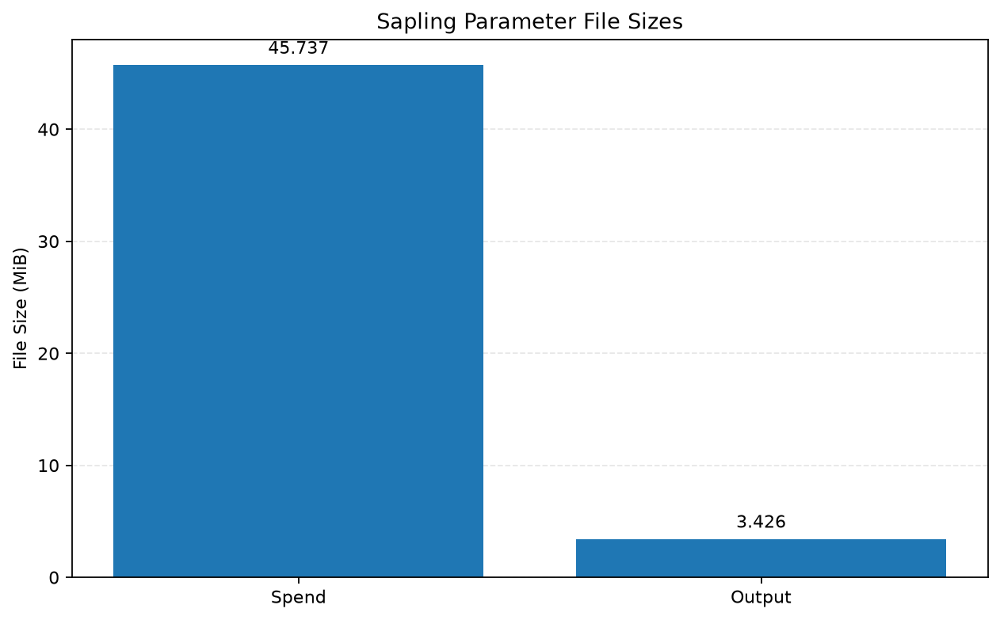
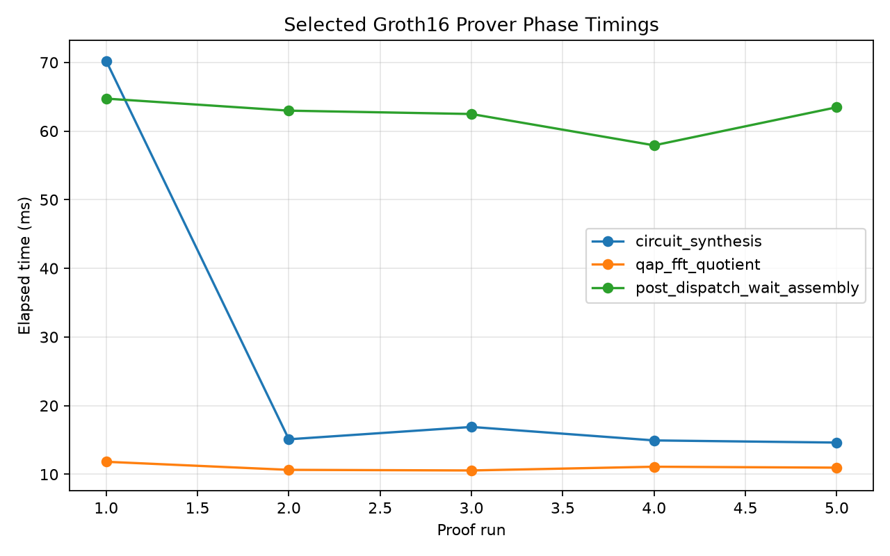
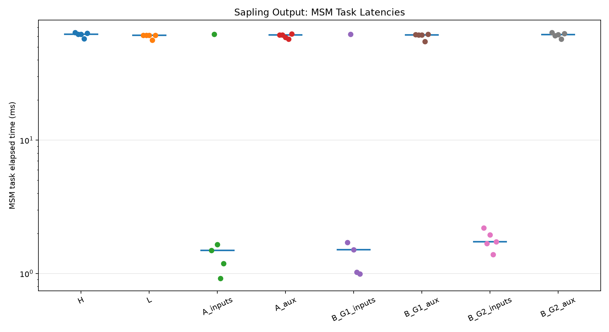

# zcash-sapling-engineering

A reproducible engineering study of Zcash Sapling zk-SNARK proving performance.

本项目针对 Zcash Sapling 的 Groth16 证明生成流程开展工程实验，重点是建立可复现的性能基线、分析现有实现的计算开销，并通过源码级 profiling 定位 Prover 端的主要性能瓶颈。

**This repository focuses on reproducible benchmarking, profiling, and bottleneck analysis rather than protocol modification or algorithm-level optimization.**

本项目当前不修改 Sapling 协议，也不宣称已经提出或实现了性能优化方案。研究重点是回答：

> Sapling Spend / Output 的证明生成时间主要消耗在哪里？现有测量证据能否支持对主要性能瓶颈的判断？

---

## 1. Research Objectives

本项目的主要目标包括：

- Reproduce Sapling Spend and Output proof generation and verification.
- Establish reproducible proving and verification benchmarks.
- Record parameter sizes, circuit complexity, resource usage, and experimental conditions.
- Trace the Groth16 proving call path into the underlying implementation.
- Profile MSM (Multi-Scalar Multiplication) operations and analyze their contribution to proving cost.
- Identify performance bottlenecks before considering any optimization.

当前研究范围是工程复现、性能测量和瓶颈定位，不包含协议修改或算法级优化。

---

## 2. Current Status

初始工程实验和基准测试工作已经完成。当前研究重点转向 Sapling Groth16 Prover 的阶段级 profiling。

### Completed Work

- [x] Sapling 参数文件获取与完整性校验。
- [x] Sapling Spend proof 生成与验证。
- [x] Sapling Output proof 生成与验证。
- [x] 参数文件规模与电路规模分析。
- [x] Release 模式下的 Prove / Verify 基准测试。
- [x] 多线程性能与内存相关实验。
- [x] 实验 provenance 审计与证据归档。
- [x] Bellman MSM 调用级源码插桩。
- [x] Spend / Output 同源码、单线程 MSM 剖析对照。
- [x] 实验数据、汇总表、图表与分析文档归档。

### Current Research Question

当前最重要的问题是：

> Where does Sapling Groth16 proof generation spend most of its time?

已有实验表明，MSM 相关操作是 Spend 和 Output 证明生成中的重要成本来源。但要解释 Spend 的完整 Prove 时间，还需要进一步核对各阶段的计时边界、任务执行情况，以及未被现有测量覆盖的部分。

当前工作尚未完成 Spend 全流程的互不重叠阶段耗时分解。

---

## 3. Experimental Environment

| Item | Configuration |
|---|---|
| Operating system | Windows 11 |
| Programming language | Rust |
| Build profile | Release, where specified by the experiment |
| Parallelism | Controlled through the tested Rayon configurations |
| Proof system | Groth16 zk-SNARK |
| Pairing curve | BLS12-381 |
| Engineering target | Zcash Sapling Spend / Output |
| Main profiling target | Bellman MSM operations |

主要依赖版本：

| Dependency | Version |
|---|---|
| `sapling-crypto` | 0.9.0 |
| `bellman` | 0.15.0 |
| `groth16` | 0.2.0 |

实际构建配置、依赖来源和源码 revision 应以对应实验记录为准。不同实验批次的条件不应在未核实的情况下混用。

---

## 4. Repository Structure

下面展示仓库的主要目录、研究材料和代表性文件。为便于阅读，省略了部分原始日志、分析脚本和依赖源码文件。

```text
zcash-sapling-engineering/
├── README.md
├── weekly_summary.md
├── .gitignore
│
├── docs/
│   ├── smoke-check.md
│   ├── zcash_sapling_flow.md
│   ├── engineering_experiment_notes.md
│   ├── baseline_comparison.md
│   └── msm_profiling_notes.md
│
├── scripts/
│   ├── verify_params.py
│   ├── summarize_engineering.py
│   ├── plot_output_prover.py
│   ├── parse_msm_profile.py
│   ├── parse_msm_stage_comparison.py
│   ├── parse_worker_task_start.py
│   ├── compare_output_threads.py
│   ├── compare_msm_thread_profiles.py
│   ├── measure_process_peak_working_set.ps1
│   └── ... other experiment and analysis scripts
│
├── experiments/
│   ├── prover-smoke/
│   │   ├── Cargo.toml
│   │   ├── Cargo.lock
│   │   └── src/
│   │
│   ├── metadata/
│   │   ├── source_patches/
│   │   ├── parameter_validation.csv
│   │   ├── sapling_performance_analysis_summary_20261011.md
│   │   ├── sapling_same_source_msm_comparison_20261011.md
│   │   └── ... experiment and provenance records
│   │
│   └── raw/
│       ├── csv/
│       └── logs/
│
├── results/
│   ├── tables/
│   │   ├── engineering_performance.csv
│   │   ├── engineering_parameters.csv
│   │   ├── engineering_scale.csv
│   │   ├── engineering_memory.csv
│   │   └── ... profiling summaries
│   │
│   └── figures/
│       ├── sapling_prove_time.png
│       ├── sapling_verify_time.png
│       ├── sapling_parameter_sizes.png
│       ├── sapling_output_internal_stages.png
│       ├── sapling_output_msm_by_query.png
│       └── ... other experimental figures
│
└── vendor/
    ├── bellman/
    └── groth16/
```

### Directory Responsibilities

| Directory | Purpose |
|---|---|
| `docs/` | Engineering notes, protocol flow, baseline comparison, and profiling methodology |
| `scripts/` | Parameter validation, benchmark execution, data parsing, summaries, and plotting |
| `experiments/prover-smoke/` | Rust crate used to run Sapling proof-generation experiments |
| `experiments/raw/csv/` | Raw benchmark and profiling CSV files |
| `experiments/raw/logs/` | Raw standard output, profiling output, and diagnostic logs |
| `experiments/metadata/` | Experiment descriptions, comparison reports, manifests, and audit records |
| `experiments/metadata/source_patches/` | Archived source patches and related provenance materials |
| `results/tables/` | Summarized experimental results |
| `results/figures/` | Generated benchmark and profiling plots |
| `vendor/` | Vendored dependency sources used by the engineering experiments |

The raw evidence is retained separately from the derived tables and figures so that conclusions can be checked against the original measurements.

---

## 5. Benchmark Scope and Results

The benchmark covers two Sapling proof types:

- **Spend:** the proof-generation workload associated with a Sapling spend.
- **Output:** the proof-generation workload associated with a Sapling output.

Recorded metrics include, where applicable:

- Parameter loading and validation time.
- Verification-key preparation time.
- Input preparation time.
- Proof-generation time.
- Verification time.
- Proof size.
- Rayon thread configuration.
- Build profile and experiment batch identifiers.

The benchmark program measures these intervals separately. Timing boundaries should be checked in the relevant source code before interpreting a particular result.

### 5.1 Representative Uninstrumented Spend Benchmark

The Release benchmark batch `1791613854129` contains five runs.

| Metric | Result |
|---|---:|
| Prove median | 3385.716 ms |
| Verify success | 5 / 5 |
| Proof size | 192 bytes |
| Rayon threads | 1 |
| Build profile | Release |

This is the median of that specific batch, not a universal runtime guarantee.

Raw data:

`experiments/raw/csv/sapling_spend_prover_runs_release.csv`

Output benchmark data are preserved in:

`experiments/raw/csv/sapling_output_prover_runs_release.csv`

Other benchmark batches contain their own timings and conditions. They should not be combined without checking the build profile, instrumentation status, thread configuration, cache condition, and batch identifier.

---

## 6. Selected Results

This section highlights representative figures already generated by the repository. The raw CSV files and experiment records remain the primary evidence.

### 6.1 Proving Time


This figure summarizes the recorded proving-time results. The exact workload, run selection, and measurement conditions should be checked against the corresponding result tables.

### 6.2 Parameter Sizes



Parameter size is an important engineering cost in addition to proving and verification time. The detailed sizes and their definitions are retained in the experiment records and summary tables.

### 6.3 Output Internal-Stage Profiling



This figure reports internal-stage measurements for the **Output** workload.

It must not be interpreted as a complete stage-level decomposition of Spend proving time.

### 6.4 Output MSM Query Profile



This figure summarizes the recorded Output MSM profiling data. Query-level elapsed times should be interpreted using the measurement definitions and execution conditions of the corresponding profiling run.

Additional figures are available under `results/figures/`, including verification time, circuit scale, thread comparisons, MSM-stage comparisons, and worker task-start delay.

---

## 7. Groth16 Prover and MSM Profiling

### 7.1 Profiling Target

The current source-level profiling focuses on MSM calls made during proof generation.

MSM computes a linear combination of elliptic-curve points and is an important computational primitive in many SNARK proving implementations. Its cost depends on factors such as the number of exponents, the curve implementation, the selected window, and the execution environment.

The main instrumentation location is:

```text
vendor/bellman/src/multiexp.rs
```

The main diagnostic records are:

```text
BELLMAN_MSM_PROFILE
BELLMAN_MSM_SUBMIT_PROFILE
```

Recorded fields include:

- `call_id`
- `exponent_count`
- `density_map_size`
- `window`
- `task_start_delay_ms`
- `elapsed_ms`
- `submit_elapsed_ms`

These fields help relate individual MSM calls to their inputs and execution behavior.

### 7.2 Measurement Definitions

`BELLMAN_MSM_PROFILE` records the elapsed time measured around `multiexp_inner` in the worker task.

`BELLMAN_MSM_SUBMIT_PROFILE` records a separate interval around task submission.

These fields have different timing scopes. They must not be added together without examining their relationship and the enclosing call flow.

Moreover, individual MSM tasks may experience queuing and execution behavior that makes a simple sum of per-call durations different from a mutually exclusive wall-clock stage duration.

The reported MSM elapsed-time sum is therefore a profiling metric, not automatically a complete decomposition of the outer `prove_ms`.

---

## 8. Spend / Output Same-Source MSM Comparison

The experiment record is:

`experiments/metadata/sapling_same_source_msm_comparison_20261011.md`

Recorded conditions:

| Item | Configuration |
|---|---|
| Build profile | Release |
| Rayon threads | 1 |
| Runs per proof type | 5 |
| Algorithm-level modification | None |
| Instrumentation | MSM call-level timing enabled |

### 8.1 Spend

| Metric | Result |
|---|---:|
| Prove median | 6858.210 ms |
| Median of per-run accumulated MSM elapsed time | 5932.749 ms |
| Median of per-run MSM / Prove ratios | 87.06% |
| Verification | 5 / 5 successful |
| Proof size | 192 bytes |

### 8.2 Output

| Metric | Result |
|---|---:|
| Prove median | 885.491 ms |
| Median of per-run accumulated MSM elapsed time | 850.428 ms |
| Median of per-run MSM / Prove ratios | 93.32% |
| Verification | 5 / 5 successful |
| Proof size | 192 bytes |

For this comparison, accumulated MSM elapsed time is defined as the sum of the eight `BELLMAN_MSM_PROFILE` `elapsed_ms` records associated with each proof run. The per-run MSM / Prove ratio is that sum divided by the corresponding run's `prove_ms`.

These numbers describe the specific instrumented profiling batches. The accumulated elapsed-time ratio is **not** necessarily the fraction of total wall-clock time exclusively occupied by MSM, because task timing, queuing, and execution may overlap or have different boundaries.

### 8.3 Instrumented Versus Uninstrumented Runs

The representative uninstrumented Spend benchmark has a median proving time of `3385.716 ms`, while the same-source instrumented profiling batch has a median of `6858.210 ms`.

These figures differ substantially and must not be mixed.

The instrumentation and its runtime effects need to be considered when interpreting the profiling results. The instrumented MSM ratio must not be directly applied to the uninstrumented 3385.716 ms baseline to estimate the latter's MSM duration.

The existing results support the conclusion that MSM-related operations are an important cost contributor in the tested workloads. They do not, by themselves, provide a complete stage-level decomposition of Spend proving time.

---

## 9. Current Findings

### 9.1 Proving Is More Expensive Than Verification

In the tested workloads, proof generation takes substantially longer than verification. This makes the Prover the main focus of the current engineering investigation.

### 9.2 MSM-Related Operations Are an Important Cost Contributor

The instrumented Spend and Output experiments report substantial accumulated MSM elapsed times relative to their associated proving intervals.

MSM is therefore a high-priority target for further bottleneck analysis. The reported percentages apply to their specified profiling batches and timing definitions, not to every Sapling execution configuration.

### 9.3 Multi-Threading Improves Performance in the Tested Configurations

Thread-comparison experiments show improved proving performance in the tested configurations. Their numerical results and measurement conditions are documented in the corresponding experiment records and figures.

These results should not be generalized beyond the tested workloads and environments.

### 9.4 Spend and Output Have Different Proving Costs

Spend and Output exhibit different proving costs in the recorded experiments. Circuit workloads, witness construction, MSM input sizes, and other implementation details may affect the difference.

The runtime difference alone does not establish that any single circuit feature is its sole cause.

### 9.5 Spend Does Not Yet Have a Complete Stage-Level Decomposition

The repository contains Output internal-stage measurements and Spend / Output MSM call-level profiles.

A complete, non-overlapping Spend timing breakdown across circuit synthesis, QAP and FFT operations, MSM, witness-related work, and other prover operations remains a separate measurement task.

It should not be claimed as complete solely on the basis of MSM call logs.

### 9.6 No Algorithm-Level Optimization Has Been Introduced

The current stage focuses on engineering reproduction, benchmarking, instrumentation, and bottleneck analysis.

The measurements are intended to identify where further investigation is justified, not to claim a speedup from a new algorithm.

---

## 10. Experiment Records

The following files are useful entry points into the evidence.

| Purpose | Path |
|---|---|
| Performance analysis summary | `experiments/metadata/sapling_performance_analysis_summary_20261011.md` |
| Spend / Output same-source MSM comparison | `experiments/metadata/sapling_same_source_msm_comparison_20261011.md` |
| Measurement campaign closure | `experiments/metadata/sapling_measurement_campaign_closure_20261011.md` |
| Provenance audit | `experiments/metadata/sapling_experiment_provenance_audit_20261011_151156.md` |
| Parameter validation records | `experiments/metadata/parameter_validation.csv` |
| Spend Release benchmark data | `experiments/raw/csv/sapling_spend_prover_runs_release.csv` |
| Output Release benchmark data | `experiments/raw/csv/sapling_output_prover_runs_release.csv` |
| Output internal-stage data | `experiments/raw/csv/sapling_output_internal_stages.csv` |
| Spend same-source MSM log | `experiments/raw/logs/sapling_spend_msm_profile_same_source_20261011_102916.log` |
| Output same-source MSM log | `experiments/raw/logs/sapling_output_msm_profile_same_source_20261011_103205.log` |
| Experimental cost summaries | `results/tables/` |
| Generated figures | `results/figures/` |

Raw CSVs and logs are the primary evidence. The metadata documents explain the conditions, methods, and limitations of each result.

---

## 11. Reproducibility

The Rust experiment crate is maintained under:

`experiments/prover-smoke/`

Before running an experiment, check:

- `docs/smoke-check.md`
- The corresponding benchmark source and `Cargo.toml`
- Required parameter-file paths and validation status
- The intended Rayon thread configuration
- Whether instrumentation is enabled

Example PowerShell workflow for the Spend experiment:

```powershell
Set-Location .\experiments\prover-smoke

$env:RAYON_NUM_THREADS = "1"

cargo run --release --bin spend_prover_smoke
```

This command assumes that the required parameters and other experiment prerequisites have already been prepared as documented by the project.

For analysis scripts, inspect the script's input paths and output paths before running it. A script may depend on a specific CSV or log format from an earlier experiment.

Before comparing a new run with an existing result, preserve at least:

- Git revision.
- Build profile.
- Thread configuration.
- Proof type and workload.
- Parameter and circuit configuration.
- Cache or warm-up condition, if controlled.
- Whether profiling instrumentation is enabled.
- Raw log and CSV paths.
- Verification result.

Instrumented profiling results and uninstrumented benchmark results should be maintained as separate comparisons unless their measurement differences have been explicitly accounted for.

---

## 12. Limitations

The current analysis has several limitations.

- Results are specific to the tested software, hardware, and execution configurations.
- Individual MSM call durations do not automatically form a set of mutually exclusive stage durations.
- Instrumented profiling runs have materially different proving times from the representative uninstrumented Spend benchmark.
- A large accumulated MSM elapsed time does not directly quantify the speedup achievable by changing MSM.
- The current data do not establish whether the dominant cost within MSM is caused by a particular algorithmic sub-operation, memory behavior, scheduling mechanism, or another implementation detail.
- Thread-scaling results should be interpreted only within their recorded configurations.
- Output internal-stage measurements do not substitute for a complete Spend stage-level profile.

These limitations are stated explicitly to avoid overstating the findings.

---

## 13. Next Research Steps

The next task is to complete the remaining measurements needed to explain Spend proving time, rather than immediately changing the algorithm.

The investigation should focus on:

1. Confirming the Sapling Spend call path through `sapling-crypto`, Groth16, and Bellman.
2. Reviewing existing timing points and identifying the minimum missing stage-level measurements.
3. Measuring the relevant stages with clear, non-overlapping timing boundaries.
4. Reconciling the stage measurements with the outer `prove_ms` interval.
5. Comparing the results with the existing Groth16 baseline while documenting implementation and workload differences.
6. Preparing a report that separates measured facts, interpretations, and unresolved questions.

Potential optimization directions should be considered only after the dominant costs and their measurement boundaries have been sufficiently understood.

The current repository does not claim an optimized MSM implementation or a proven reduction in proving cost.

---

## 14. Research Principle

This project follows the principle:

> Measure first, identify the bottleneck, and only then decide whether optimization is justified.

The current deliverable is a reproducible engineering baseline and an initial source-level analysis of Sapling Groth16 proving performance.

The objective is not to claim a speedup prematurely. It is to establish reliable evidence about where proving time is spent, what the present profiling can support, and what remains unexplained.

**Current conclusion:** MSM-related operations are important cost contributors in the tested Sapling Spend and Output profiling workloads. The next task is to complete and reconcile the stage-level measurements needed to explain Spend proving time without mixing instrumented and uninstrumented results.